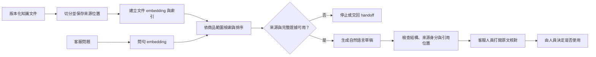

# 客服 RAG PoC 做到哪裡：可追溯的草稿，仍需要人判斷

客服系統能從文件找出一段文字，再生成一段流暢回答，並不表示這段回答就適合直接交給客人。來源版本可能不清楚，回答也可能把原文意思說反、漏掉條件，或把應由人員處理的事情寫成已經完成。

這個 PoC 用合成的耳機保養、連線與政策文件，串起切分、embedding、檢索、回答草稿與知識更新流程。它的成果是一條可追溯的技術路徑，以及清楚列出的能力邊界。它不是已驗收的自動客服：目前定位是客服人員打開來源核對後再使用的草稿。

> **閱讀範圍**：本文以目前收尾中的 PoC 為主；所有資料都是合成內容。文中提到的 live 問答發生在較早版本，只能說明當時的單題執行結果，不能代表目前版本的語意品質或完整驗收。

## 從知識文件到回答草稿

一份知識文件會先依標題與段落切成較小片段。每段保留文件中原始位置、標題路徑、版本與內容雜湊，讓系統之後可以把引用連回來源。現行切分上限是 1,200 個 Python 字元；它不是 tokenizer 的 token 上限，也沒有宣稱是最佳切法。字元上限讓規則簡單，但長行或段落邊界仍可能形成不理想的切片。

文件片段會依固定的 embedding 身分保存向量與來源資料。使用者提問時，系統先依商品範圍篩選，再用問句向量和保存的向量做 cosine 排序。這個分數只用來排序候選來源，不是答案正確率，也沒有低分門檻可代表「模型有把握」。檢索到片段，只表示系統找到了可供下一步參考的材料。

接著系統準備有界的證據，交給生成器寫自然語言草稿。解析器會確認回答符合欄位格式、引用指向已知來源，span 對得上原文位置，回答文字也被引用範圍完整涵蓋；handoff 的欄位彼此一致。若來源缺失、資料版本不一致，或完整證據放不進既有界線，流程會停止或交回 handoff，而不截掉來源後繼續生成。這些檢查確保的是結構與可追溯性，不是句意正確。

*圖 1：資料流程示意，根據目前程式責任分層整理，並非產品畫面。結構檢查之後仍有人工語意判斷；現行 UI 沒有強制放行按鈕或核准閘門。*

## 檢索與生成各自負責什麼

檢索負責在指定商品與可用知識範圍內，挑出相關候選片段。排序採 exact cosine；相同文件的候選可按原文件結構帶入完整片段，並受既有 evidence 數量、字元與傳輸容量限制。檢索不負責判定回答，也不能保證需要的內容一定已被找齊，特別是答案依賴不同文件時。

生成負責把收到的證據整理成自然語言，並依輸出契約提供回答或 handoff。固定指示要求保留條件、禁止、必做與停止事項，也要求每項主張標示來源位置。但位置不是語意支持證明：即使 span 真正存在於引用原文，回答仍可能與那段文字相反、加入無根據的說法，或省略重要限制。解析器也無法從任意問句可靠推斷「這件事一定要交人工」。

我們曾嘗試用文字標記與簡單字詞交集，把語意支持、限制完整性和人工處置變成自動判斷；反例顯示這些規則會漏掉同義表達，也會把正常問題誤判。依 D-018，這些不成立的語意判定已撤回。保留來源、版本、hash、span、schema 與傳輸檢查，是為了守住可驗證的工程邊界，不代表語意品質已修好。

## 知識更新：版本可追溯，流程展示不等於正式啟用

PoC 也展示了知識如何從文件掃描、核對內容身分、建立候選、比較結果，走到暫存環境中的切換與重啟讀回。對 FAQ 或政策文字做更新時，候選以輸入內容和向量身分區分；失敗切換會保留舊 snapshot，讓流程可以檢查目前指向哪個版本。這有助於追問「草稿依據哪一版」，也讓失敗時能辨認應保留的狀態。

但目前交付指南中的完整 rehearsal 使用暫存目錄、mock embedding、mock generation 與假核准資料，並封鎖外部連線。它驗證的是本機控制流程及版本切換，不是對真實文件重做向量、正式發布候選或證明更新後答案更好。PR #15 最終合併版本的離線檢查與 review 沒有重跑真生成或啟用候選。FAQ baseline 舊錯誤的根因仍未知；FAQ 與政策版本的驗證仍未完成。這些差距不能靠一次成功的 mock rehearsal 填平。

## 歷史 live 小樣本與 mock 證據分開看

本 repo 內的 PR #11 記錄了舊版單題入口的一次 live 回答；同一 PR 的前一次送出停在未知計費欄位錯誤，沒有回答。PR #12 則記錄另一個較後、但仍早於目前主線的舊 SHA，對一題 `POST /ask` 回覆 HTTP 200 並帶來源引用。兩筆成功記錄的 `usage` 都是 `null`，用量未知，不應寫成零或推算費用。較早的 PR #15 核准版本 [`09e24d1`](https://github.com/bing-kuo/customer-support-rag/commit/09e24d1e48ac71768dab08600feb8b47d04e17ce) 另有四個合成 dev 案例的歷史生成結果，四案當時均取得回答、用量均未知。這些結果分屬不同舊版，不合併計算成功率或外推為目前版本品質、完整評測或 P2 驗收通過；PR #15 最終合併版本沒有重跑 live 問答。由於本 repo 為 private，以上 PR／commit 連結僅供具 repo 存取權的讀者查看，外部讀者可能無法開啟。[PR #11](https://github.com/bing-kuo/customer-support-rag/pull/11) · [PR #12](https://github.com/bing-kuo/customer-support-rag/pull/12)

較新的離線 mock 測試和 PR #15 合併版本的 review 展示另一種證據：程式可以在假 transport 下檢查來源完整性、未知引用、容量停止與輸出契約，也可以重現某些結構合法但語意錯誤的例子。它們能驗證程式控制流程和邊界處理，不能替代真模型生成的人工評分，更不能把舊失敗改標成通過。[PR #15 合併版本](https://github.com/bing-kuo/customer-support-rag/commit/f7ec860a01ad447a9cb639fcb474b597b62f4fc6) · [PR #15 討論](https://github.com/bing-kuo/customer-support-rag/pull/15)

目前仍有已知的語意失敗與未驗項。P2 保持 acceptance-open，security hold 未解除；既有候選沒有取得正式 release approval，也沒有啟用。這些狀態是結案文章必須保留的結果，不因為本次 PoC 文件收尾而改變。

## 為什麼選自然草稿加人工核對

我們選擇保留自由提問和自然改寫，讓原型能呈現客服人員可能需要的互動方式，同時把輸出定位為草稿。這比把回答限制為固定 FAQ 或全面改成逐字摘錄更接近原本要探索的使用情境，也保留了生成內容較容易犯錯的特性，因此需要人員核對原文。

「人工核對」是預期的作業方式，不是系統已強制執行的流程。現有 UI 不會要求客服逐題按下核准才能放行，也不會自動判定何時必須交人工。若人員略過來源檢查，程式目前沒有第二道 UI 閘門替他補做判斷。這項限制不應被「草稿」標籤掩蓋。

## 取捨與協作上的教訓

一開始我們把「答案裡有正確引用」看得太接近「答案受到來源支持」，也試圖用小型字串規則代替人類判斷。審查反例指出，引用位置、必要條件和處置意圖是不同問題；把它們收成一個自動綠燈，會讓看似完整的輸出掩蓋錯誤。這次修正不是找出一個通用語意 oracle，而是撤回無法成立的保證，清楚標示哪些可以由程式檢查，哪些仍要人工閱讀。

另一個教訓是不要把每種驗證都混成同一個「通過」。Mock 測試回答「控制流程是否按預期停止或交接」；歷史 live 單題回答「那個舊版本當時是否回過一題」；語意評估則要判斷回答是否真正支持、保留限制並選對處置。它們回答不同問題，不能把數字或結論拼成整體品質聲明。未知用量保持未知，失敗保持失敗，未執行的驗證保持未驗。

本次選擇在這個 PR 收斂文件與文章，而不繼續擴大產品實作去追求通用語意正確性。這讓 PoC 可以在明確限制下完成說明，但不是把限制當成已解決。往後若評估更高風險的使用方式，需要另行設計有界的語意評估與人工工作流程，再由決策者決定是否進一步核准；本文不表示那些工作已排程、已通過或已授權。

## 結語

這個 PoC 展示了從版本化知識、向量檢索到自然回答草稿的端到端技術路徑，也讓我們看見工程上可追溯的引用與語意正確之間仍有一道差距。把它當成學習 RAG、檢視來源與討論客服草稿流程的原型，是合適的；把它當成已驗收、可無人監督使用的客服系統，則超出了目前證據。

對這類系統，最值得追問的不只是「有沒有生成答案」，還包括：答案依據哪一份資料、引用是否真的支持每個主張、限制有沒有保留，以及不確定時由誰接手。這些問題目前仍需要客服人員讀原文後回答。
